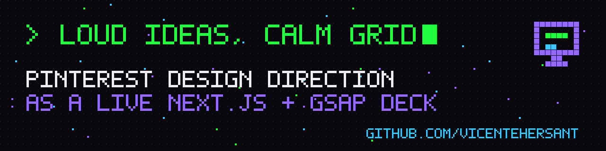
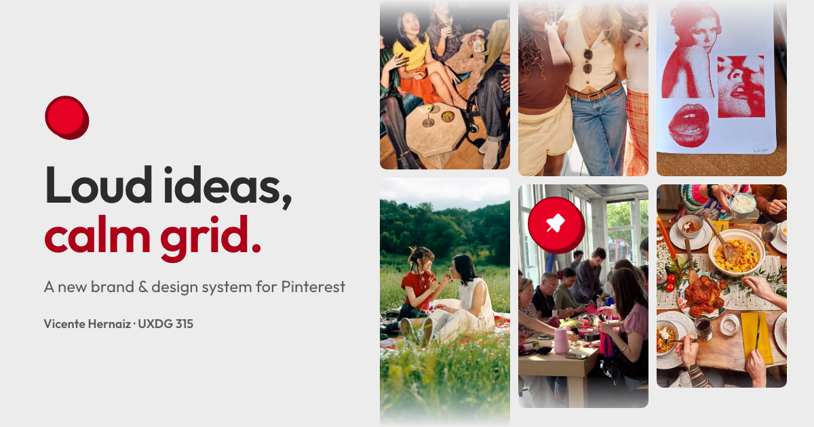

# Loud Ideas, Calm Grid

**Live deck → [loud-ideas-calm-grid.vercel.app](https://loud-ideas-calm-grid.vercel.app)**

A design-direction presentation for a Pinterest redesign (UXDG 315 · Front-End Design, SCAD), built as a website instead of slides.



## Why I present in code
Slides flatten interaction design. Building the deck as a web app lets me:
- **Show motion for real.** Press-and-hold, pin hover, board save and color search are live components the audience can watch, not GIFs.
- **Share one link.** A QR code on screen opens the same deck on everyone's phone.
- **Reuse the work.** The deck uses the same tokens and components as the design system it presents.

## How it's built
| Part | What it does |
|---|---|
| `components/Deck.tsx` | 29-step story (Context → Insights → Idea → Evidence → Impact) with keyboard navigation and GSAP reveals |
| `components/motion-cards/` | Interactive demos of each micro-interaction (`PressCard`, `PinHoverCard`, `BoardSaveCard`, `ColorSearchCard`, `TabBarCard`, `TypeBlockCard`) |
| `app/canvas` · `components/MoodCanvas.tsx` | Infinite moodboard canvas |
| `app/process` · `components/ProcessCanvas.tsx` | Process board showing research and iterations |
| `app/og-card`, `opengraph-image.png` | Social preview card |
| `qrcode.react` | QR on screen so the audience can follow on their phones |

**Stack:** Next.js 16 (App Router) · React 19 · Tailwind CSS v4 · GSAP · Phosphor Icons · deployed on Vercel.

## My workflow
1. **Story first.** Outline the narrative as named steps before any visuals (see `STEP_NAMES` in `Deck.tsx`).
2. **Tokens before slides.** Colors, type and spacing come from the redesign's design system, so the deck is the first consumer of the system.
3. **One component per idea.** Each insight that involves interaction gets a live motion card.
4. **Ship to a URL.** Deploy to Vercel, add an OG image and QR code, and rehearse on the real link.

## Run locally
```bash
npm install
npm run dev
```

## Credits
Design and code by [Vicente Hernaiz](https://vicentehernaiz.tech). Moodboard images are third-party reference material collected for a student project and remain the property of their owners. Pinterest is a trademark of Pinterest, Inc.; this is an unofficial student concept, not affiliated with Pinterest.
